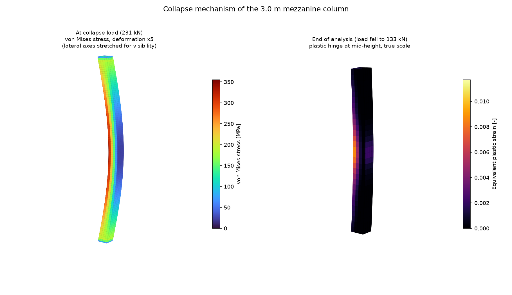
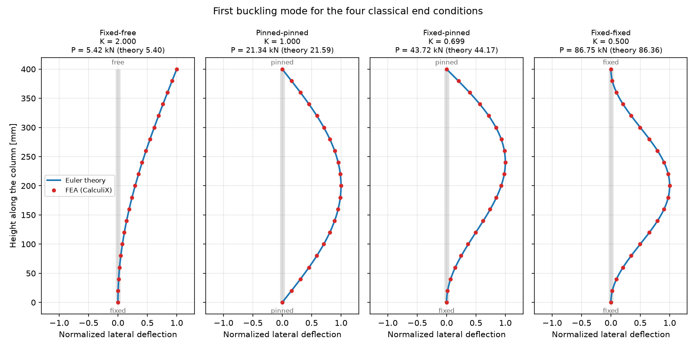
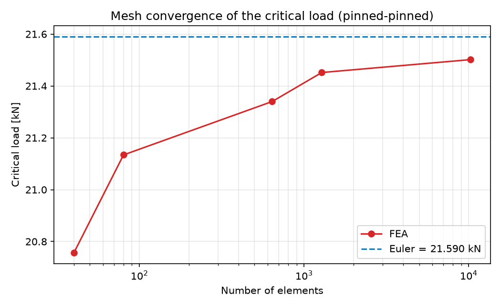
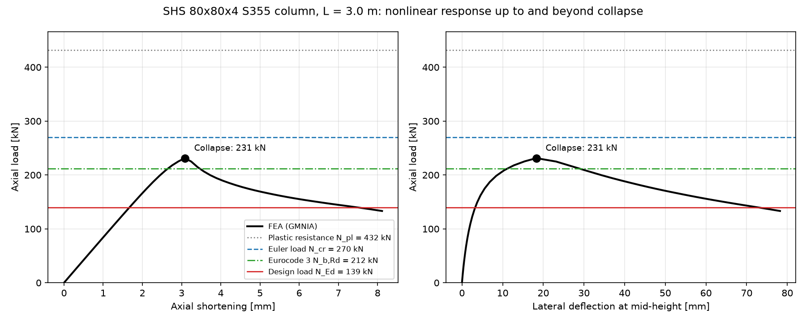
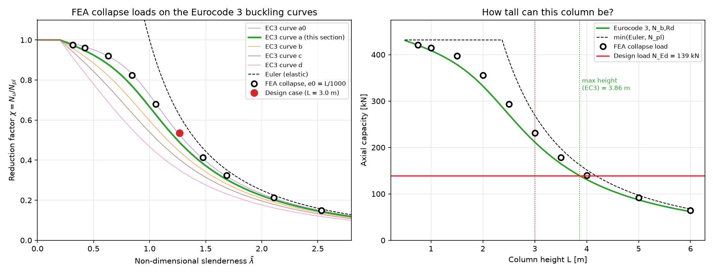
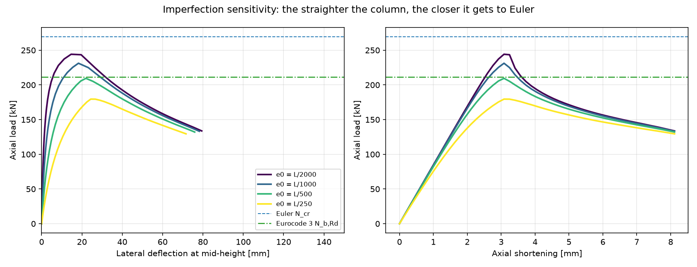

# Column Buckling: from Euler to a Real Collapse Analysis (Gmsh + CalculiX + Python)

Two fully scripted buckling studies. Part 1 verifies linear buckling against Euler's classical solutions. Part 2 uses the same tools on a real engineering question: **will a steel mezzanine column hold its design load, and how much margin does it have?** The answer comes from a geometric and material nonlinear collapse analysis (GMNIA), checked against Eurocode 3.



---

## Part 1: Linear buckling verified against Euler

A 400 x 20 x 10 mm steel column (C3D8I hexahedra, 640 elements) is solved with CalculiX `*BUCKLE` for the four classical end conditions. Each end condition is modeled with real constraints on the solid end faces: a hinge restrains only the centroid axially, so the face can rotate, and a guided end ties the whole face together with `*EQUATION`, so it cannot rotate but can still shorten.

| End conditions | K | Euler [N] | FEA [N] | Difference | MAC |
|---|---|---|---|---|---|
| Fixed-free | 2.000 | 5,397 | 5,421 | +0.44% | 1.00000 |
| Pinned-pinned | 1.000 | 21,590 | 21,340 | −1.16% | 1.00000 |
| Fixed-pinned | 0.699 | 44,167 | 43,717 | −1.02% | 0.99997 |
| Fixed-fixed | 0.500 | 86,359 | 86,746 | +0.45% | 0.99999 |



The FEA mode shapes match the analytical ones with MAC ≥ 0.9999. Euler's formula is P_cr = π²EI / (KL)². For the fixed-pinned case, K comes from the root of tan(kL) = kL (kL = 4.4934).

**Mesh convergence (pinned-pinned):** refining from 40 to 10,240 elements takes the error from −3.9% to −0.4%, converging monotonically on the Euler value.



---

## Part 2: Real case, a storage mezzanine column

### The problem

| Item | Value |
|---|---|
| Column | SHS 80x80x4 (hot-finished square hollow section), S355 steel |
| Height and supports | 3.0 m, pinned at both ends |
| Tributary floor area | 3.0 m x 3.5 m = 10.5 m² |
| Permanent load | 1.5 kN/m² (deck, joists, finishes) |
| Imposed load | 7.5 kN/m² (storage, EN 1991-1-1 category E1) |
| Design load (ULS) | N_Ed = (1.35 × 1.5 + 1.5 × 7.5) × 10.5 = **139.4 kN** |

### Hand calculation (Eurocode 3, EN 1993-1-1)

| Quantity | Value |
|---|---|
| Section (wall midline, sharp corners) | A = 1216 mm², I = 117.1 cm⁴, i = 31.0 mm |
| Section class | c/t = 17.0 ≤ 33ε = 26.8 → **Class 1**, no local buckling before yield |
| Squash load N_pl | 431.7 kN |
| Euler load N_cr | 269.6 kN |
| Slenderness λ̄ | 1.265 |
| Buckling curve a (α = 0.21) | χ = 0.490 |
| Buckling resistance N_b,Rd | **211.6 kN** |
| Utilization N_Ed / N_b,Rd | **0.66 → OK** |

### The FEA model

- **Mesh:** S4 shell elements on the wall midline (Gmsh, structured quads, 1,632 elements at L = 3 m), with stiff end plates.
- **Supports:** the centre of each end plate is a hinge. The bottom is fixed in x, y and z, the top is free to shorten only, and one extra node stops the column from spinning about its axis.
- **Material:** elastic-plastic S355 (f_y = 355 MPa, hardening slope E/10,000).
- **Geometry:** an initial bow imperfection, a half sine wave with amplitude e0 = L/1000, the EN 1090-2 straightness tolerance.
- **Analysis:** NLGEOM (large displacements) with an imposed top shortening instead of a force. This lets the analysis follow the load past its peak, so the collapse load is the maximum of the load-shortening curve.

### Result for the design case

| | Value |
|---|---|
| FEA collapse load N_u | **231.2 kN** |
| Eurocode 3 resistance N_b,Rd | 211.6 kN |
| Design load N_Ed | 139.4 kN |
| Safety factor against FEA collapse | **1.66** |
| At collapse | shortening 3.08 mm, mid-height deflection 18.3 mm (initial bow 3.0 mm) |
| Tallest column for this load | **3.86 m** (EC3), 4.01 m (FEA) |

**Verdict: the column is safe**, with a utilization of 0.66. The FEA collapse load is 9% above the code value, which is the expected direction (see the discussion below).



The response is linear at first. The imperfection then grows, and the bending it causes adds to the axial stress. Yielding starts on the concave side at mid-height, a plastic hinge forms, and the load drops. The mid-height deflection grows from 3 mm to 18 mm before the peak, which is the whole buckling story in one curve.

### FEA vs Eurocode 3 over the full slenderness range

The complete nonlinear analysis was repeated for ten lengths from 0.75 m to 6 m.



| L [mm] | λ̄ | N_cr Euler [kN] | N_cr FEA [kN] | N_u FEA [kN] | N_b,Rd EC3 [kN] | FEA / EC3 |
|---|---|---|---|---|---|---|
| 750 | 0.316 | 4313.3 | 3815.4 | 421.1 | 420.3 | 1.002 |
| 1000 | 0.422 | 2426.2 | 2296.9 | 414.5 | 408.8 | 1.014 |
| 1500 | 0.633 | 1078.3 | 1054.6 | 397.5 | 378.7 | 1.050 |
| 2000 | 0.844 | 606.6 | 599.9 | 355.5 | 332.3 | 1.070 |
| 2500 | 1.055 | 388.2 | 385.5 | 293.4 | 270.9 | 1.083 |
| 3000 | 1.265 | 269.6 | 268.3 | 231.2 | 211.6 | 1.093 |
| 3500 | 1.476 | 198.1 | 197.6 | 178.2 | 165.2 | 1.079 |
| 4000 | 1.687 | 151.6 | 151.4 | 139.9 | 131.0 | 1.068 |
| 5000 | 2.109 | 97.0 | 97.1 | 91.8 | 87.2 | 1.052 |
| 6000 | 2.531 | 67.4 | 67.3 | 64.6 | 61.9 | 1.043 |

**Reading the results**

- **The FEA follows the shape of the code curve across the whole range**, between 0% and 9% above curve a. The largest gap is at λ̄ ≈ 1.0 to 1.3, the zone where yielding and instability interact the most. That is exactly where residual stresses, which this model leaves out, reduce real capacity the most. The code includes them, so it should sit below the model there.
- **Short columns** (λ̄ < 0.4) reach almost the full squash load: failure is yielding, not buckling.
- **Long columns** (λ̄ > 2) approach the Euler load: failure is elastic instability.
- **Linear buckling matches Euler within 0.5%** for the slender columns. At 0.75 m the FEA is 11.5% lower because shear deformation, which Euler ignores, becomes significant in a short column. This does not matter in practice, since the squash load governs there.

### Imperfection sensitivity



| Initial bow e0 | N_u [kN] | Change vs L/1000 |
|---|---|---|
| L/2000 (1.5 mm) | 244.2 | +5.6% |
| L/1000 (3.0 mm) | 231.2 | reference |
| L/500 (6.0 mm) | 209.5 | −9.4% |
| L/250 (12.0 mm) | 179.5 | −22.4% |

A 12 mm bow on a 3 m column, barely visible to the eye, removes 22% of the capacity. This is why straightness tolerances exist. The Eurocode 3 value (211.6 kN) falls between the L/1000 and L/500 results, which is consistent with the code's idea of an *equivalent* imperfection that also covers residual stresses.

### Mesh check

| Mesh | N_u [kN] |
|---|---|
| 4 elements per side, 30 mm long (1,632 elements) | 231.2 |
| 8 elements per side, 15 mm long (≈6,400 elements) | 231.1 (−0.06%) |

The collapse load is mesh independent.

---

## How to run

Requirements: Python 3.10+ and [CalculiX](http://www.calculix.de/) (`ccx`, included in [PrePoMax](https://prepomax.fs.um.si/) on Windows).

```bash
pip install -r requirements.txt
```

Set the solver path at the top of each script (`CCX = r"C:\path\to\ccx_dynamic.exe"`), then:

```bash
python part1_euler_verification.py    # about 20 s
python part2_column_collapse.py       # 24 analyses, run in parallel, a few minutes
```

Figures, a text report and a CSV with every result are written to `results_part1/` and `results_part2/`.

## Assumptions and limits

- Midline section with sharp corners. A catalogue SHS 80x80x4 has rounded corners and slightly different properties (A ≈ 1.15 × 10³ mm²).
- No residual stresses, which is why the FEA sits above the code curve.
- Ideal pinned ends. Real base plates give some rotational restraint, which would raise the capacity.
- γ_M1 = 1.0 (recommended value in EN 1993-1-1; check the National Annex).

## Possible extensions

- Residual stress field for hot-finished sections, to compare directly with curve a
- A slender (Class 4) section, where local and global buckling interact
- Eccentric load and a beam-column interaction check (EN 1993-1-1, 6.3.3)
- Automatic selection of the lightest SHS from a catalogue for a given load and height
